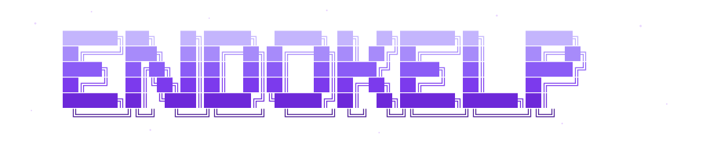

I'm Anirudh. High school in Bellevue. I make web apps and AI tools.

[endokelp.com](https://endokelp.com) · [endoblog.dev](https://endoblog.dev) · venni.devireddy@gmail.com

<table>
  <tr>
    <td align="center" valign="top" width="50%">
      <a href="https://github.com/Endokelp/Endoplexity">
         
        <b>Endoplexity</b>
      </a>
       
      Browser agents on your own Claude or Cursor login
    </td>
    <td align="center" valign="top" width="50%">
      <a href="https://fintell.app">
         
        <b>FinTell</b>
      </a>
       
      Stock research
    </td>
  </tr>
  <tr>
    <td align="center" valign="top" width="50%">
      <a href="https://vaidra.org">
         
        <b>Vaidra</b>
      </a>
       
      Audiobooks and courses in regional Indian languages
    </td>
    <td align="center" valign="top" width="50%">
      <a href="https://forcelogic.io">
         
        <b>SiteBot</b>
      </a>
       
      A chatbot that only answers from the client's own site
    </td>
  </tr>
  <tr>
    <td align="center" valign="top" width="50%">
      <a href="https://github.com/Endokelp/NextStep">
         
        <b>NextStep</b>
      </a>
       
      Career maps for high schoolers
    </td>
    <td align="center" valign="top" width="50%">
       
      <b>Hypnos</b>
       
      Caffeine and light for night shifts. 2nd, Washington State Science Fair
    </td>
  </tr>
  <tr>
    <td align="center" valign="top" width="50%">
      <a href="https://github.com/Endokelp/Only-Skill-You-Need">
         
        <b>Only Skill You Need</b>
      </a>
       
      First skill a beginner installs. Routes the rest.
    </td>
    <td align="center" valign="top" width="50%">
      <a href="https://github.com/Endokelp/Should-I-build">
         
        <b>Should I Build?</b>
      </a>
       
      BUILD / PIVOT / STOP with receipts
    </td>
  </tr>
  <tr>
    <td align="center" valign="top" width="50%">
      <a href="https://github.com/Endokelp/DecisionCouncil">
         
        <b>DecisionCouncil</b>
      </a>
       
      Ranked verdict when the decision is expensive
    </td>
    <td align="center" valign="top" width="50%">
       
      <b>JARVIS</b>
       
      Coming soon
    </td>
  </tr>
</table>

Also: Pasupa, [Valuation AI](https://pricing-self-six.vercel.app/), [LaCrosse Wagon](https://caraige.vercel.app), [Interlake HI](https://www.interlakehi.org/), [ihsAquatics](https://www.ihsaquatics.org/)

TypeScript, Next.js, Python, FastAPI, Supabase, Three.js.

Open to internships, freelance, and education / nonprofit work.

