**Anirudh Devireddy** &nbsp;·&nbsp; high school senior in Bellevue, WA

I put AI inside real systems: drinking-water rules, bird-safe glass, teen labor law, drone detection, classrooms. Most of it is public, with the numbers next to the code.

[endokelp.com](https://endokelp.com) &nbsp;·&nbsp; [endoblog.dev](https://endoblog.dev) &nbsp;·&nbsp; [venni.devireddy@gmail.com](mailto:venni.devireddy@gmail.com)

## One habit, applied to different domains

Map the system, find the step where a model changes the outcome, then test it on data the model never saw.

## Research

<table>
  <tr>
    <td valign="top" width="30%">
      <b>Drinking-water TTHM warnings</b> 
      Independent research, mentored by Prof. Gregory Korshin, University of Washington
    </td>
    <td valign="top">
      Total trihalomethanes (TTHM) are disinfection byproducts the EPA regulates. I analyzed 7,149 water systems and tested seasonal warning rules on held-out data. They caught 13.5% more exceedances than the EPA rule while sending 15.8% fewer alerts.
    </td>
  </tr>
  <tr>
    <td valign="top">
      <b>Does rotating partners change collusion?</b> 
      Apart Research AI Collusion Sprint, October 2026
    </td>
    <td valign="top">
      LLM agents that verify each other's work end up accepting it, even when rejecting is the only compliant action (Shi, Zhang and Yang, 2026). I tested whether DeepSeek-V4-Flash agents accept less when every partner is a stranger. Fixed partners accepted 81%, strangers 73%: a drop of 8 points (nominal 95% interval +1 to +16). That met neither pre-registered call, so I report it as inconclusive. <a href="https://apartresearch.com/sprints/projects/rotating-verifier-partners-in-deepseekv4flash-an-inconclusive-8point-drop-in-acceptance-a5su">Read the report</a>
    </td>
  </tr>
  <tr>
    <td valign="top">
      <b>Hypnos</b> 
      Computational biology, 2nd place, Washington State Science Fair
    </td>
    <td valign="top">
      A reinforcement-learning model of the brain's circadian clock that plans light and caffeine for night-shift workers.
    </td>
  </tr>
  <tr>
    <td valign="top">
      <b>CSAwesome2</b> 
      Research intern, University of Michigan School of Information
    </td>
    <td valign="top">
      Ongoing research on AI-assisted computer science learning inside the CSAwesome2 / Runestone Academy AP CS A curriculum: 10 adopted contributions, 65 exercises and 4 exams. <a href="https://github.com/Endokelp/CSAwesome2">Fork</a>
    </td>
  </tr>
</table>

## Built for competitions, 2026

<table>
  <tr>
    <td valign="top" width="42%">
      
    </td>
    <td valign="top">
      <b><a href="https://github.com/Endokelp/Off-The-Clock">Off the Clock</a></b> 
      RevenueCat Shipaton 2026 
      An Android app that tells working teenagers what their employer owes them. Log a shift by hand or from a photo of the posted schedule. A rules engine built from Washington's minor labor law flags each violation, quotes the statute and adds up the unpaid time in dollars.  
      Expo, TypeScript, RevenueCat. 55 tests. <a href="https://youtu.be/txb_xofC8QA">Watch the demo</a>
    </td>
  </tr>
  <tr>
    <td valign="top">
      
    </td>
    <td valign="top">
      <b><a href="https://github.com/Endokelp/Bird_safe_OpenCV">Bird-safe gap check</a></b> 
      OpenCV AI Competition 2026 
      Bird-safe window markings only work when no gap is wider than about 2 inches. Tape a printed calibration sheet to the glass, take one phone photo, and OpenCV 5 on AWS Lambda answers pass, repair here or retake. On a real window it measured 60.5 mm against 61 mm expected. 173 tests.  
      <a href="https://iwny3i3fsawk2mlo3au4dcyrzi0cyepf.lambda-url.us-east-2.on.aws/">Try it live</a>
    </td>
  </tr>
  <tr>
    <td valign="top">
      
    </td>
    <td valign="top">
      <b><a href="https://github.com/Endokelp/listening-post">Listening Post</a></b> 
      Congressional App Challenge 2026 
      Acoustic drone detection that runs in a phone browser with no added hardware. Two seconds of sound become 53 numbers, a classifier scores them, and an alert needs 3 of the last 5 windows to agree. It flagged 80 to 94% of drone windows from labs it had heard and 0 to 7% from a lab it had not. The repo opens with that limit.  
      <a href="https://endokelp.github.io/listening-post/">Open the app</a>
    </td>
  </tr>
</table>

## Products and open source

<table>
  <tr>
    <td align="center" valign="top" width="50%">
      <a href="https://github.com/Endokelp/Endoplexity">
         
        <b>Endoplexity</b>
      </a> 
      Browser agents on your own Claude or Cursor login. Open source, 156 tests. 
      
    </td>
    <td align="center" valign="top" width="50%">
      <a href="https://vaidra.org">
         
        <b>Vaidra</b>
      </a> 
      Free audiobooks and courses in regional Indian languages. A nonprofit with government school and NGO partners across 450+ schools and 60k+ students.
    </td>
  </tr>
  <tr>
    <td align="center" valign="top">
      <a href="https://fintell.app">
         
        <b>FinTell</b>
      </a> 
      Stock research
    </td>
    <td align="center" valign="top">
      <a href="https://forcelogic.io">
         
        <b>SiteBot</b>
      </a> 
      A chatbot that only answers from the client's own site
    </td>
  </tr>
  <tr>
    <td align="center" valign="top">
      <a href="https://github.com/Endokelp/NextStep">
         
        <b>NextStep</b>
      </a> 
      Local-first career maps for high schoolers. No server, no account
    </td>
    <td align="center" valign="top">
      <a href="https://github.com/Endokelp/Only-Skill-You-Need">
         
        <b>Only Skill You Need</b>
      </a> 
      The first skill a beginner installs. It routes the rest. 
      
    </td>
  </tr>
  <tr>
    <td align="center" valign="top">
      <a href="https://github.com/Endokelp/Should-I-build">
         
        <b>Should I Build?</b>
      </a> 
      BUILD, PIVOT or STOP, with receipts
    </td>
    <td align="center" valign="top">
      <a href="https://github.com/Endokelp/DecisionCouncil">
         
        <b>DecisionCouncil</b>
      </a> 
      A ranked verdict, with dissent, when the decision is expensive
    </td>
  </tr>
</table>

In progress: **Pasupa** (in-sack crop-spoilage sensors) and **JARVIS**. 
Sites built for others: [Valuation AI](https://pricing-self-six.vercel.app/) · [LaCrosse Wagon](https://caraige.vercel.app) · [Interlake HI](https://www.interlakehi.org/) · [ihsAquatics](https://www.ihsaquatics.org/)

 

TypeScript · Python · Next.js · FastAPI · Supabase · OpenCV · Expo · AWS Lambda · Three.js

Open to internships, freelance, and education or nonprofit work.

