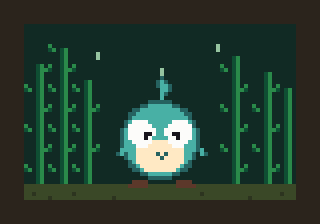

# Hey, I'm Venkata Anirudh (Endokelp)

  

Frond. A kelp. 32×32 pixels, four-frame idle. Not an image model.

High school builder in Bellevue, WA. I ship full-stack apps and AI systems that actually deploy.

[endokelp.com](https://endokelp.com) · [endoblog.dev](https://endoblog.dev) · venni.devireddy@gmail.com

## Shipped

- **[Endoplexity](https://github.com/Endokelp/Endoplexity)** — agentic browser control on your own Claude / Cursor subscriptions
- **[FinTell](https://fintell.app)** — stock research. Scores from formulas, not the LLM inventing numbers
- **[Vaidra](https://vaidra.org)** — nonprofit audiobooks and courses in regional Indian languages
- **SiteBot** — site chatbots that only answer from the client's own content. Case study on [endokelp.com](https://endokelp.com)
- **Hypnos** — RL advisor for night-shift caffeine/light on a circadian model. 2nd, Washington State Science Fair
- **JARVIS** — personal OS (voice, calendar, memory). Private. Demo via the site

Also: NextStep, Pasupa, [Valuation AI](https://pricing-self-six.vercel.app/), client sites ([ForceLogic](https://forcelogic.io), [LaCrosse Wagon](https://caraige.vercel.app), [Interlake HI](https://www.interlakehi.org/), [ihsAquatics](https://www.ihsaquatics.org/), [Flash Forward](https://gofund.me/436b67db))

TypeScript, Next.js, Python, FastAPI, Supabase, Three.js.

**Open to:** SWE internships · freelance AI integrations · education / nonprofit collabs
